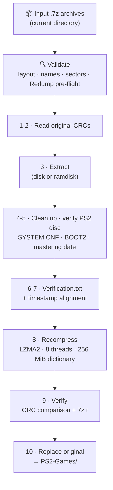

<div align="center">


# 💿 PS2 Archive Cleanser ☄️

**Extract, verify, clean and recompress your PlayStation 2 game archives, in one command.**

Turns a folder of `.7z` PS2 dumps into a consistent, verified, fast-to-extract library.

[](https://github.com/zencatalyst/ps2-archive-cleanser/releases/latest)
[](#-license)


[Features](#-features) · [Quick start](#-quick-start) · [How it works](#%EF%B8%8F-how-it-works) · [Options](#%EF%B8%8F-options) · [Safety](#%EF%B8%8F-safety-and-what-gets-changed) · [FAQ](#-troubleshooting)

</div>

---

## ✨ Features

- **Aggressive, extraction-friendly recompression.** LZMA2 with 8 threads and a 256 MiB dictionary. Every archive is built with 2 or 3 independent internal blocks (depending on whether it also holds `.jxl` and/or `.pdf` files), so 7-Zip, PeaZip and similar tools can extract with 8+ threads. The extraction speed-up is 4.5–10× compared to single-threaded LZMA archives.
- **Strict input validation.** Flat root directory, matching file names (including multi-track `Name (Track n).bin` layouts), valid CUE `FILE` references, and exact sector alignment (2048-byte ISO or 2352-byte raw BIN).
- **Real PS2 disc checks.** Inspects the disc filesystem for a root `SYSTEM.CNF`, a `BOOT2 = cdrom0:` entry, and the boot executable inside the image.
- **Two-stage [Redump](http://redump.org/) verification.** Drop a Redump PS2 `.dat` file next to your archives and the script checks name, size and CRC32 *before* extraction, then name, size and SHA-1 on the extracted discs.
- **Embedded manifest.** A `Verification.txt` with the BOOT2 executable, the Redump verification status, and CRC32, SHA-1, SHA-512 and SHA3-512 checksums is added to every archive.
- **Consistent timestamps.** Disc files keep their original ISO-9660 mastering date, and the archives themselves are stamped in a neat, predictable sequence.
- **Safe by design.** Every new archive is CRC-compared against the original and, by default, tested with `7z t` before it replaces anything. Ctrl-C cleans up after itself.
- **Interactive or unattended.** Answer a few prompts, or run a whole library with `-y` from a script or cron job.
- **Optional ramdisk staging.** `--ramdisk-dir` extracts to a `tmpfs`/`ramfs` mount to spare your SSD/HDD a full extraction write.

## 🚀 Quick start

```bash
# 1. Get the script
git clone https://github.com/zencatalyst/ps2-archive-cleanser.git
chmod +x ps2-archive-cleanser/ps2_archive_cleanser.sh

# 2. Go to the folder that holds your .7z game archives
cd ~/ps2-archives

# 3a. Interactive mode: you confirm each step
/path/to/ps2-archive-cleanser/ps2_archive_cleanser.sh

# 3b. ...or unattended: keep the first archive's timestamp as the base
/path/to/ps2-archive-cleanser/ps2_archive_cleanser.sh -y -t first
```

> [!WARNING]
> The script **replaces your input archives** with the cleaned versions (moved into `PS2-Games/`) and **deletes any `.txt` files inside them**. Run it on a **copy** of your library until you are comfortable with the results. See [Safety](#%EF%B8%8F-safety-and-what-gets-changed).

The script always works on the **current directory**, so run it from the folder that contains your `.7z` files.

## 📋 Requirements

### Software

| Requirement | Notes |
| :--- | :--- |
| **GNU/Linux** | Relies on the GNU userland (`date`, `stat`, `find`, `sort`, `df`) and `/proc/meminfo`. |
| **Bash 5.x** | Tested with Bash 5.2. |
| **[7-Zip](https://www.7-zip.org/)** (`7z`) | Tested with 7-Zip 23.01. |
| **[RHash](https://github.com/rhash/RHash)** (`rhash`) | Tested with RHash 1.4.3. |
| **[bchunk](http://he.fi/bchunk/)** (`bchunk`) | Used to inspect BIN/CUE CD images. |
| `awk` and the usual core utilities | `gawk` or `mawk` both work. |

The script checks for `7z`, `rhash` and `bchunk` at startup and tells you if one is missing.

```bash
# Fedora
sudo dnf install 7zip rhash bchunk

# Debian / Ubuntu
sudo apt install 7zip rhash bchunk
```

On other distributions, install the equivalents so that the `7z`, `rhash` and `bchunk` commands are on your `PATH`.

### Hardware

The compression step uses about **11.4 GiB (~12.2 GB) of RAM**, and `--ramdisk-dir` needs up to **~8.5 GiB (~9.1 GB) more** to stage a DVD-9 image in memory. With too little free memory the system may freeze; swap space lets the compression finish, just more slowly.

| Tier | RAM | CPU | Storage (min. 24 GiB free) |
| :--- | :--- | :--- | :--- |
| **Minimum** (tolerable) | 16 GB + 4 GB swap | 4 cores (min. 8 threads) | 2.5" HDD |
| **Medium** (moderate) | 16 GB + 8 GB swap | 8 cores (min. 12 threads) | 3.5" HDD |
| **High-end** (high) | 24 GB + 8 GB swap | 12 cores (min. 16 threads) | 2.5" SSD |
| **Ultimate** (maximum) | 32 GB | 16 cores (min. 24 threads) | NVMe SSD |

## 📁 What goes in, what comes out

### Input

Place your `.7z` archives in the working directory. Each archive must be **flat** (no subfolders) and its disc files must be named after the archive:

```text
Game (USA).7z
└── Game (USA).iso              # DVD game: one ISO
    Game (USA).txt              # optional, will be removed
    Game (USA).jxl / .pdf       # optional extras, kept

Game (Europe).7z
├── Game (Europe).bin           # CD game: one BIN + CUE
└── Game (Europe).cue

Game (Japan).7z
├── Game (Japan) (Track 1).bin  # multi-track CD: Redump-style track names
├── Game (Japan) (Track 2).bin
└── Game (Japan).cue
```

Only disc images and their companions (`.iso`, `.bin`, `.cue`, `.txt`, `.jxl`, `.pdf`) are accepted; any other file type (for example `.nfo` or `.jpg`) is rejected. The optional `.txt`, `.jxl` and `.pdf` extras can have any name. Anything that doesn't pass validation stops the run *before* any file is moved, with a message that names the offending archive.

### Output

```text
your-archives/
├── PS2-Games/                          ← cleaned, verified archives end up here
│   ├── Game (USA).7z
│   └── Game (Europe).7z
└── Skipped-PS2-Game-Archives/          ← duplicates you chose to skip
```

During a run, two temporary folders, `temporary-extracted-archives/` and `temporary-processed-archives/`, hold the work in progress and are removed when the run ends.

Each finished archive contains the disc files, your `.jxl`/`.pdf` extras (if any) and a fresh `Verification.txt`.

## ⚙️ How it works



| Step | What happens |
| :---: | :--- |
| **1–2** | Reads the CRC32 of every file in the original archive. |
| **3** | Extracts the archive and shows each file with its hash (SHA-1 by default). |
| **4** | Removes redundant `.txt` files. |
| **5** | Verifies the PS2 disc structure and reads the internal ISO-9660 mastering date. |
| **6** | With a Redump DAT: SHA-1 verification of the extracted discs. Writes `Verification.txt`. |
| **7** | Stamps `Verification.txt` and any `.jxl`/`.pdf` files. |
| **8** | Recompresses with `-m0=LZMA2 -mmt=8 -mx=9 -md=256m -mfb=256 -ms=16g -mqs=on`. |
| **9** | Compares every CRC against the original and (by default) runs `7z t` on the new archive. |
| **10** | Replaces the original, moves it to `PS2-Games/`, and prints a before/after size comparison. |

At the end you get a summary with the total time, the number of archives processed, and the total library size before and after.

### Timestamps

- **Disc files** (`.iso`, `.bin`) are stamped in UTC with their original ISO-9660 mastering timestamp; `.cue` sheets are stamped 1 second later.
- **Archives and auxiliary files** (`Verification.txt`, `.jxl`, `.pdf`) are regularized in sequence: **+1 minute per archive, +1 second per file**, starting from a base timestamp. The base is either the **first archive's modification time** or an **ISO 8601 timestamp you choose** (`YYYY-MM-DDTHH:mm:ss±hh:mm`, minimum `2014-01-01T00:00:00Z`). The chosen timezone offset is recorded in `Verification.txt`.

### Redump verification

1. Download the PlayStation 2 datfile from [redump.org](http://redump.org/datfile/ps2/).
2. Put the `.dat` file in the same folder as your archives.
3. Run the script. It detects the file automatically (interactive mode asks you to confirm; `-y` enables it by default).

Archives that are missing from the DAT, or whose files don't match it, are reported by name.

## 🎛️ Options

Run `./ps2_archive_cleanser.sh --help` for the full text. All flags except `-h`, `-v` and `--ramdisk-dir` work only together with `-y`; this keeps unattended runs explicit.

| Option | Description | Default with `-y` |
| :--- | :--- | :--- |
| `-h`, `--help` | Show help and exit. | |
| `-v`, `--version` | Show version and license information and exit. | |
| `-y`, `--yes` | Non-interactive mode: answers *yes* to the workflow prompts (scanning, validation, creating `PS2-Games/`, launching). **Requires `-t`.** | |
| `-t`, `--timestamp <ISO8601\|first>` | Base archive timestamp: a custom ISO 8601 value, or `first` to keep the first archive's modification time. Also accepts `--timestamp=<value>`. | *required* |
| `--redump-verification`<br>`--no-redump-verification` | Enable or disable Redump `.dat` verification. Aborts if enabled but no `.dat` is found. | enabled |
| `--skip-existing`<br>`--overwrite-existing` | Skip archives that already exist in `PS2-Games/` (moving them to `Skipped-PS2-Game-Archives/`), or reprocess and overwrite them. | skip |
| `--integrity-test`<br>`--no-integrity-test` | Run (or skip) `7z t` on each new archive in step 9. | enabled |
| `--display-hash <SHA-1\|SHA-512\|SHA3-512>` | Hash algorithm shown for extracted files in step 3. Also accepts `--display-hash=<value>`, or `1`/`2`/`3`. | `SHA-1` |
| `--ramdisk-dir <DIR>` | Extract into `<DIR>/temporary-extracted-archives` on a `tmpfs`/`ramfs` mount. Works in interactive **and** `-y` mode. | off |
| `--force-with-risks` | Let `-y` proceed despite low RAM (< 16 GB, or < 24 GB with `--ramdisk-dir`), under 24 GiB of free disk space, or under 9 GiB of free ramdisk space. | off |

### Examples

```bash
# Unattended, base timestamp = first archive's modification time
./ps2_archive_cleanser.sh -y -t first

# Unattended, custom base timestamp (with timezone), SHA-512 shown in step 3
./ps2_archive_cleanser.sh -y -t 2020-03-04T00:00:00+09:00 --display-hash SHA-512

# Reprocess archives that already exist in PS2-Games/, skip the 7z t test
./ps2_archive_cleanser.sh -y -t first --overwrite-existing --no-integrity-test

# Stage extractions in RAM (needs a tmpfs mount such as /dev/shm)
./ps2_archive_cleanser.sh -y -t first --ramdisk-dir /dev/shm

# Interactive mode with a ramdisk
./ps2_archive_cleanser.sh --ramdisk-dir /dev/shm
```

### Interactive mode

Without `-y` the script walks you through a short sequence of prompts. Pressing **Enter** accepts the default shown in brackets, and the destructive-looking ones default to **No**.

| # | Prompt | Default |
| :-: | :--- | :-: |
| 1 | Scan for game archives in the current directory? | No |
| 2 | Verify against the Redump DAT file? *(or: proceed without Redump verification?)* | Yes *(No)* |
| 3 | Proceed with the directory-structure scan and validation? | Yes |
| 4 | *(if duplicates exist)* Overwrite the existing archives? | No (skip them) |
| 5 | Keep working with these archives? | No |
| 6 | *(if missing)* Create `PS2-Games`? | No |
| 7 | Change the base timestamp? *(then enter an ISO 8601 value)* | Yes |
| 8 | Run the `7z t` integrity test on new archives? | Yes |
| 9 | Which hash to display (1–3)? | 1 (SHA-1) |
| 10 | Everything set. Launch the task? | Yes |

On systems below the recommended hardware, extra *"Do you want to proceed anyway?"* warnings appear first (RAM, free disk space and, with `--ramdisk-dir`, free ramdisk space), all defaulting to **No**.

## 🛡️ Safety and what gets changed

**What the script does to your files**

- Each input archive is **replaced** by its cleaned version, which is then **moved into `PS2-Games/`**. Keep a backup until you have checked the results.
- **`.txt` files inside archives are deleted** (a `Verification.txt` is generated instead).
- With `--skip-existing` (the default with `-y`), input archives whose names already exist in `PS2-Games/` are **moved to `Skipped-PS2-Game-Archives/`**; a same-named file already in that folder is overwritten.
- A rejected run can leave an empty `PS2-Games/` behind, and duplicates may already have been moved.

**What protects your data**

- Everything is validated up front. A bad archive stops the run *before* any archive is modified.
- A new archive only replaces the original after its **CRC32s match the original's**, and (unless disabled) after `7z t` passes.
- If verification fails, the original stays untouched and both the extracted files and the suspect archive are **kept for inspection** in the staging folders (the message names the paths).
- On **Ctrl-C** (or `SIGTERM`), the script kills running child processes, removes partial archives and staging folders, and exits with code `130`.
- It refuses to start if a leftover staging folder exists, and never deletes a path it didn't create.
- A memory guard stops processing if system memory usage reaches 99%.

> [!TIP]
> Stop a run with **Ctrl-C**. A plain `kill <pid>` (`SIGTERM` sent only to the script) waits for the file currently being hashed to finish.

### Exit codes

| Code | Meaning |
| :-: | :--- |
| `0` | Success, nothing to do, or you declined a prompt. |
| `1` | Error: invalid options, failed validation or verification, or EOF at a prompt. |
| `130` | Interrupted (Ctrl-C or `SIGTERM`); cleanup was performed. |

All output goes to **stdout**, so progress lines and messages stay in order.

## 🧯 Troubleshooting

<details>
<summary><b>"Found an existing file or directory at …/temporary-extracted-archives"</b></summary>

A previous run was interrupted, a verification step failed (the staging folders are intentionally kept), or another instance is running right now. If no other instance is running, remove both `temporary-extracted-archives` and `temporary-processed-archives` (and the one on your ramdisk, if you use `--ramdisk-dir`) and run again. The message lists every colliding path in one go.

</details>

<details>
<summary><b>"Archive integrity test failed" or "CRC mismatch detected"</b></summary>

Your original archive is untouched. The extracted files and the new archive are left in `temporary-extracted-archives/<Game>` and `temporary-processed-archives/<Game>.7z` so you can investigate. With `--ramdisk-dir`, the extracted files stay in RAM until you delete them, and the script says so.

</details>

<details>
<summary><b>"Found an archive named … that does not seem to be a game archive"</b></summary>

The archive failed validation: it needs a flat layout, file names that match the archive name, a valid CUE sheet for BIN images, and only the accepted file types. Fix or remove it and run again; no file has been modified at that point.

</details>

<details>
<summary><b>The RAM / disk / ramdisk warning appears</b></summary>

The script uses a lot of memory while compressing. Interactive mode lets you proceed anyway (default *No*); with `-y` you need `--force-with-risks`. Adding swap makes it possible on small machines, at the cost of speed.

</details>

<details>
<summary><b>"Directory … is not backed by a ramdisk (tmpfs or ramfs) filesystem"</b></summary>

`--ramdisk-dir` only accepts a directory on `tmpfs` or `ramfs` (for example `/dev/shm`). The directory must exist and be writable.

</details>

## 🤝 Contributing

Bug reports and pull requests are welcome. The script is ShellCheck-clean, so please keep it that way:

```bash
shellcheck ps2_archive_cleanser.sh
bash -n ps2_archive_cleanser.sh
```

When reporting a problem, include the output of `./ps2_archive_cleanser.sh --version`, your distribution, the versions of `7z`, `rhash` and `bchunk`, and the console output of the run.

## ⚖️ Legal note

This project does not download or distribute game content; it only processes archives you already have. You are responsible for complying with the laws that apply to you.

## 📜 License

Copyright © 2026 zencatalyst.

Released under the **GNU General Public License, version 2 or later** (at your option). See [`LICENSE`](LICENSE) and `./ps2_archive_cleanser.sh --version` for the full notice.

## 🙏 Acknowledgements

Built on the shoulders of [7-Zip](https://www.7-zip.org/), [RHash](https://github.com/rhash/RHash), [bchunk](http://he.fi/bchunk/) and the preservation work of the [Redump](http://redump.org/) project.
